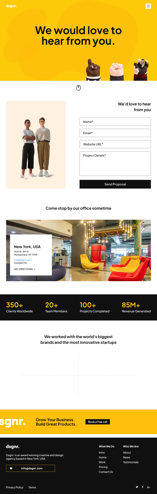
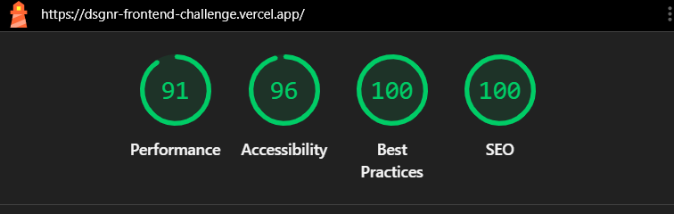

# dsgnr. Contact Page

Contact page for a design agency, built with React and Tailwind CSS from a Figma design. It has nine sections, a working contact form and a responsive layout.

- Live link: [https://dsgnr-frontend-challenge.vercel.app](https://dsgnr-frontend-challenge.vercel.app/)
- Repository: [https://github.com/Arjunp04/dsgnr-frontend-challenge](https://github.com/Arjunp04/dsgnr-frontend-challenge)

## Screenshots

| Desktop (1440px) | Mobile (375px) |
| --- | --- |
|  |  |

## Lighthouse (mobile, live link)




## Run locally

You need Node.js 20 or newer. Use the `main` branch.

**Option 1: clone with Git**

```bash
git clone --branch main https://github.com/Arjunp04/dsgnr-frontend-challenge.git
cd dsgnr-frontend-challenge
```

**Option 2: download the ZIP**

1. Open the repository on GitHub and make sure the branch shown is `main`.
2. Click Code, then Download ZIP, and unzip it.
3. Open the folder in a terminal: `cd dsgnr-frontend-challenge-main`

**Then, for both options:**

```bash
npm install
npm run dev
```

Open the link shown in the terminal (usually `http://localhost:5173`).

To check the production build, run `npm run build` and then `npm run preview`.

## Tech stack and why

- **React with Vite**: asked for in the assignment. Vite is fast and simple. Only functional components and hooks are used.
- **Tailwind CSS v4**: responsive styles are written next to the markup. Colors, custom font sizes and breakpoints are set once in `src/styles/index.css`. I also made a few small custom utilities (`page-container`, `text-body`, `text-subheading`, `text-large`) so long responsive class lists are not repeated. Everywhere else I used the default Tailwind classes.
- **Prettier**: formats the code and keeps the Tailwind classes in a standard order.
- **Native fetch and plain React state**: the form has four fields and one request, so I did not add a form library or an API library.
- **Plus Jakarta Sans (Google Fonts)**: the Figma file uses Roobert Trial, which is a paid font and not on Google Fonts. Plus Jakarta Sans is free and has a similar geometric style.
- **Content in a data file**: all text, stats, links and logos are in `src/data/content.js` and rendered with `map`.

## Folder structure

```
src/
  assets/        images, icons and logos
  components/    Button, FormField, LogoCell, FooterLinkColumn
  sections/      Header, Hero, ContactForm, Office, Stats,
                 BrandLogos, CtaBanner, Footer, BottomBar
  data/          content.js
  services/      sendProposal.js (API request)
  utils/         validators.js (form rules)
```

## Breakpoints

Only the desktop design is in Figma. The other layouts are my decision.

| Name | Width | Use |
| --- | --- | --- |
| base | below 375px | small phones |
| `xs` | 375px | phones |
| `sm` | 648px | large phones |
| `md` | 768px | tablet |
| `lg` | 1024px | laptop |
| `xl` | 1440px | desktop, matches Figma |

Above 1440px the content stays 1440px wide and centered. At 1440px the text sizes are the Figma values. Smaller screens use smaller sizes that I chose.

## Decisions where the Figma was not specific

| Part | Decision |
| --- | --- |
| Header menu | Not designed. The hamburger opens a full-screen yellow overlay with the footer links. It closes with Escape, a link click or the toggle button. Page scroll is locked while it is open. |
| Hero | Hands are centered on small screens and right-aligned from 768px. The mouse icon links to the contact form, and smooth scroll is turned off for users who prefer reduced motion. |
| Contact section | Illustration on top and form below under 1024px, side by side from 1024px. |
| Form errors | Not designed. Errors are red text (`#d92d20`) under the field with a red border. |
| Office | Under 768px the address card sits below the photo. From 768px it is over the photo. "Get Directions" opens a Google Maps search for the address in a new tab. Address, phone and email are the placeholder values from the design. |
| Stats | One column under 648px, two columns up to 1023px, one row from 1024px. |
| Brand logos | Two columns under 1024px, four from 1024px. The doc allows 2 or 3 on tablet, but 8 logos do not divide evenly by 3. Divider lines come from a 1px gap over a background color, so they show only between cells. Logo cells only change color on hover because they are not links, so they do not take keyboard focus. |
| CTA banner | Under 375px only text and button. Hands appear from 375px. From 768px it is one row with the logo, cropped on the left from 1024px. The button links to the contact form because no URL was given. |
| Footer | Link columns stacked on phones, side by side from 768px, and in one row with the brand block from 1024px. |
| Links | Menu, footer, social, Privacy Policy and Terms use `#` because no destinations were given. |
| Hover and focus | Buttons get lighter, footer links turn yellow, form fields get a yellow border, logo cells get a light background. Links, buttons and fields show a 2px outline on keyboard focus. |

## Contact form

- All four fields are required. Email must be a valid email, website must be a valid `http` or `https` URL, and project details need at least 20 characters.
- Fields are checked when the user leaves them and again on submit. No error shows before a field is touched.
- Each error is under its field and linked to the input with `aria-describedby`. Each input has a label (hidden visually).
- A valid form is sent with `POST` to `https://jsonplaceholder.typicode.com/posts`. The button is disabled and shows "Sending..." meanwhile.
- On success a message shows and the form is cleared. On failure an error message shows and the typed values stay.
- The code checks `response.ok`, because `fetch` does not fail on HTTP errors like 404 or 500.

## What I would improve with more time

- Add small animations (for example on scroll and when the menu opens) to make the page more interactive.
- Improve the hamburger icon and the menu layout.
- Convert the remaining PNG images to WebP and add width and height to every image.
- Replace the `#` links with real pages.
- Use the original Roobert font if a license is available.
- Test on real phones and tablets. I tested in Chrome DevTools responsive mode.
